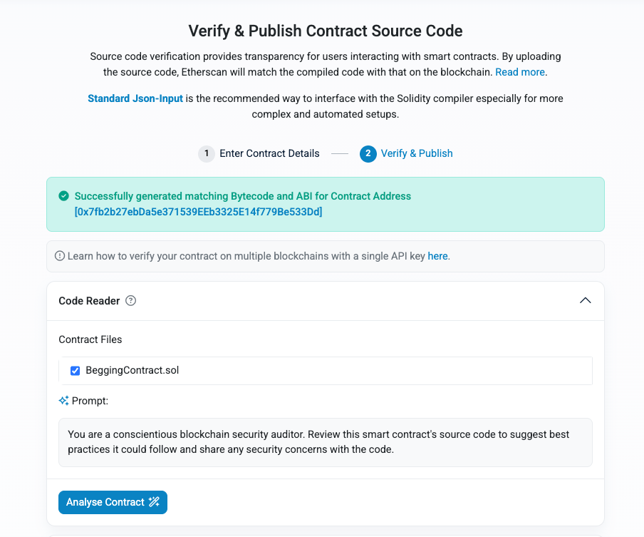
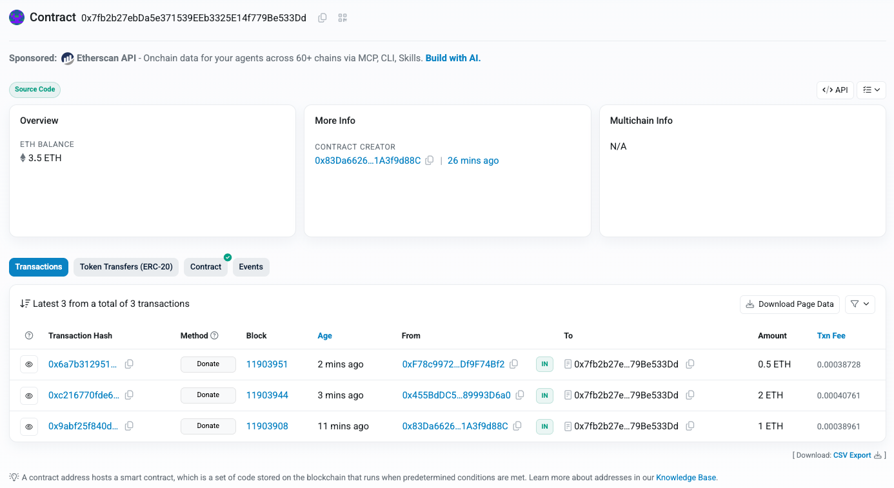
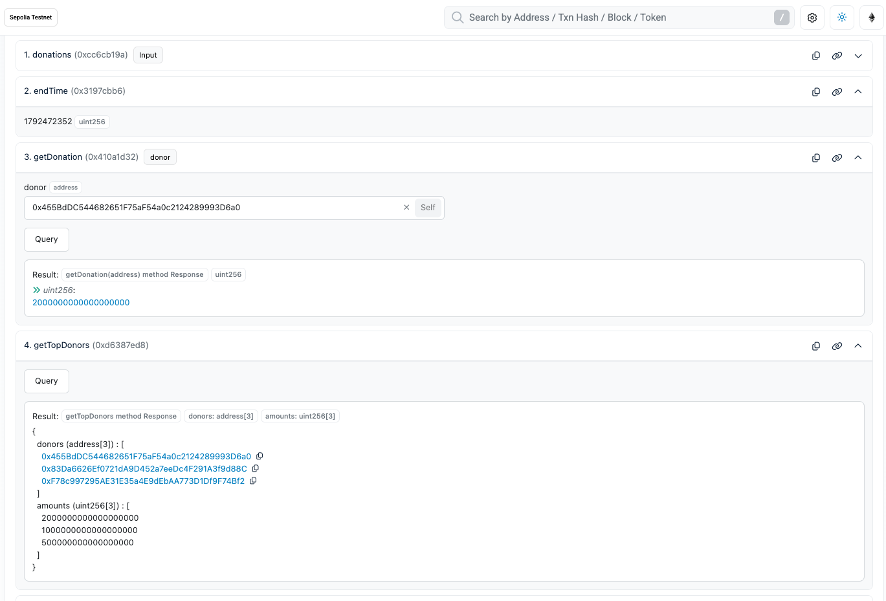

# 作业 3：讨饭合约 BeggingContract

用户可以向合约捐赠 ETH，合约记录每个捐赠者的累计金额，合约所有者可以提取全部资金。可选的三项额外挑战（捐赠事件、捐赠排行榜、时间限制）都已实现。

## 一、合约代码

源码：[BeggingContract.sol](./BeggingContract.sol)

| 功能 | 实现 |
| --- | --- |
| 记录捐赠 | `mapping(address => uint256) donations`，记录每个地址的累计捐赠金额（单位 wei） |
| `donate()` | `payable` 函数，金额取 `msg.value`；直接向合约地址转账会通过 `receive()` 走同样的逻辑 |
| `withdraw()` | 用 `onlyOwner` 限制只有所有者能调用，一次提取合约全部余额 |
| `getDonation(address)` | 查询某个地址的累计捐赠金额 |
| 额外挑战 1：捐赠事件 | 每次捐赠触发 `Donation(donor, amount)` |
| 额外挑战 2：捐赠排行榜 | `getTopDonors()` 返回累计金额最多的前 3 个地址及其金额；排行榜在每次捐赠时更新，查询时不需要遍历所有捐赠者 |
| 额外挑战 3：时间限制 | 只能在 `[startTime, endTime]` 时间段内捐赠，部署后默认开放 7 天；所有者可以调用 `setDonationPeriod` 修改 |

> `withdraw` 使用 `call` 转账而不是 `transfer`：`transfer` 只给接收方 2300 gas，如果所有者是合约钱包（比如多签），可能会转账失败。

## 二、合约地址

| 项目 | 内容 |
| --- | --- |
| 网络 | Sepolia 测试网 |
| 合约地址 | [`0x7fb2b27ebDa5e371539EEb3325E14f779Be533Dd`](https://sepolia.etherscan.io/address/0x7fb2b27ebDa5e371539EEb3325E14f779Be533Dd) |
| 部署交易 | [`0xd5512fac…4bf5380`](https://sepolia.etherscan.io/tx/0xd5512face2634cfa9e87b91e983e40a558f4e4d939e4642811a2a39ce4bf5380) |
| 所有者（部署者） | `0x83Da6626Ef0721dA9D452a7eeDc4F291A3f9d88C` |
| 编译器 | solc 0.8.37，optimizer 关闭 |
| 源码验证 | 已在 Etherscan 验证通过，可以直接在网页上查看源码和调用函数 |

部署方式：Foundry

```bash
forge create BeggingContract.sol:BeggingContract \
  --rpc-url https://ethereum-sepolia-rpc.publicnode.com \
  --account deployer --broadcast
```

## 三、测试截图

### 1. 在 Etherscan 上验证源码

上传 Standard JSON Input（[BeggingContract.standard-input.json](./BeggingContract.standard-input.json)）后，Etherscan 生成的字节码与链上一致，验证通过。



### 2. donate：三个账户分别捐赠

三笔 `Donate` 交易都成功上链，合约余额为 1 + 2 + 0.5 = 3.5 ETH。

| 捐赠账户 | 金额 |
| --- | --- |
| `0x83Da…d88C`（部署者） | 1 ETH |
| `0x455B…D6a0` | 2 ETH |
| `0xF78c…74Bf2` | 0.5 ETH |



### 3. getDonation 和 getTopDonors：查询捐赠金额与排行榜

- `getDonation(0x455B…D6a0)` 返回 `2000000000000000000` wei，即 2 ETH，和实际捐赠金额一致。
- `getTopDonors()` 按累计金额从高到低返回：2 ETH > 1 ETH > 0.5 ETH，排序正确。


