# 大作业：NFT 拍卖市场

基于 Hardhat 开发的 NFT 拍卖市场：

- 出价可以用 ETH，也可以用 ERC20 代币。
- 通过 Chainlink 喂价把不同币种的出价统一换算成美元，再比较高低。
- 拍卖合约使用 **UUPS 代理模式**，部署后可以升级。
- 已完成额外挑战：**动态手续费**。

## 一、项目结构

```
homework03/
├── contracts/
│   ├── MyNFT.sol              ERC721 NFT：owner 铸造，持有人可以转移
│   ├── NFTAuction.sol         拍卖合约（UUPS 可升级）：上架 / 出价 / 结束拍卖 / 价格换算 / 动态手续费
│   ├── NFTAuctionV2.sol       升级演示版本，新增 version() 函数
│   └── mocks/
│       ├── MockERC20.sol        本地测试用 ERC20（6 位小数）
│       └── MockV3Aggregator.sol 本地测试用 Chainlink 喂价
├── scripts/deploy.js          Sepolia 部署脚本
├── test/NFTAuction.test.js    单元测试 + 集成测试
├── hardhat.config.js
└── .env.example               环境变量模板
```

## 二、功能说明

### 1. NFT 合约：MyNFT

| 函数 | 说明 |
| --- | --- |
| `mint(to)` | 只有 owner 能调用，给 `to` 铸造一个 NFT，tokenId 从 0 开始递增 |
| `transferFrom` / `safeTransferFrom` / `approve` | 继承自 OpenZeppelin ERC721 标准实现 |

### 2. 拍卖合约：NFTAuction

| 函数 | 说明 |
| --- | --- |
| `createAuction(nft, tokenId, startPriceUsd, duration)` | **创建拍卖**：卖家需要先 `approve`，上架时 NFT 转进合约托管。起拍价单位是美元，8 位小数，例如 `1000000000` 表示 $10 |
| `bid(auctionId, token, amount)` | **出价**：`token = 0x0` 表示用 ETH 出价，金额取 `msg.value`；否则是 ERC20 出价，需要先 `approve`。出价折合美元后必须高于当前最高价，被超过的出价人会**自动收到退款** |
| `endAuction(auctionId)` | **结束拍卖**：到截止时间后任何人都可以调用。NFT 转给出价最高者，成交款扣除手续费后转给卖家；没人出价时 NFT 退回卖家 |
| `getUsdValue(token, amount)` | **价格换算**：调用 Chainlink `latestRoundData()`，把金额换算成美元（8 位小数） |
| `setPriceFeed(token, feed)` | 只有 owner 能调用，为某个币种配置 Chainlink 喂价 |
| `getFeeBps(usdValue)` | 根据成交价返回手续费率，单位是基点（1 bp = 0.01%） |

### 3. Chainlink 预言机

- 出价时调用 `AggregatorV3Interface.latestRoundData()` 读取实时价格。
- 不同币种的精度不一样：ETH 是 18 位，USDT 是 6 位，喂价本身是 8 位。合约会把它们统一换算成 8 位小数的美元，这样 ETH 出价和 ERC20 出价才能直接比较。
- 每次出价触发的 `BidPlaced` 事件里带有折算后的 `usdValue`，方便前端展示。

### 4. 合约升级（UUPS）

- `NFTAuction` 继承了 `UUPSUpgradeable`，`_authorizeUpgrade` 限制只有 owner 能升级。
- 用户始终和 ERC1967 代理合约交互。升级时只替换背后的实现合约，代理地址和里面存的数据都不变。
- 实现合约在构造函数里调用了 `_disableInitializers()`，防止别人直接初始化实现合约。

### 5. 额外挑战：动态手续费

按成交价折合的美元分档收费，成交价越高费率越低。手续费在结束拍卖时从成交款里扣除，转给平台（合约 owner）：

| 成交价 | 费率 |
| --- | --- |
| 低于 $1,000 | 3% |
| $1,000 到 $10,000 之间 | 2% |
| $10,000 及以上 | 1% |

## 三、部署步骤

```bash
# 1. 安装依赖
npm install

# 2. 配置环境变量：复制 .env.example 为 .env，填入以下变量
#    SEPOLIA_RPC_URL=https://ethereum-sepolia-rpc.publicnode.com
#    PRIVATE_KEY=部署账户私钥
#    ETHERSCAN_API_KEY=（用于验证源码，可选）

# 3. 本地测试
npx hardhat test
npx hardhat coverage

# 4. 部署到 Sepolia
npm run deploy:sepolia
```

部署脚本依次完成以下几件事：

1. 部署 MyNFT。
2. 用 `upgrades.deployProxy` 部署 NFTAuction 的实现合约和 ERC1967 代理，并调用 `initialize()`。
3. 配置 ETH 和 USDT 的 Chainlink 喂价。
4. 自检：读一次 1 ETH 和 100 USDT 折合多少美元，确认喂价配置正确。

部署输出：

```
部署账户: 0x83Da6626Ef0721dA9D452a7eeDc4F291A3f9d88C
MyNFT: 0x7f25CceE06E0e6E4A43bB2D05Aa748707343c495
NFTAuction 代理: 0xD26429D7E3CeeA027A19d0A37F06429026257D5D
NFTAuction 实现: 0x86aAC6602a715819E8393B8dCB5B952595627784
已设置 ETH/USD 喂价
已设置 USDT 喂价（使用 USDC/USD）
自检 1 ETH   = 2506.4 USD
自检 100 USDT = 99.987212 USD
```

## 四、部署地址（Sepolia）

| 合约 | 地址 | 源码验证 |
| --- | --- | --- |
| MyNFT | [`0x7f25CceE06E0e6E4A43bB2D05Aa748707343c495`](https://eth-sepolia.blockscout.com/address/0x7f25CceE06E0e6E4A43bB2D05Aa748707343c495) | Etherscan ✅ / Blockscout ✅ |
| **NFTAuction 代理**（用户交互地址） | [`0xD26429D7E3CeeA027A19d0A37F06429026257D5D`](https://eth-sepolia.blockscout.com/address/0xD26429D7E3CeeA027A19d0A37F06429026257D5D) | Etherscan ✅（已识别为代理）/ Blockscout ✅ |
| NFTAuction 实现合约 | [`0x86aAC6602a715819E8393B8dCB5B952595627784`](https://eth-sepolia.blockscout.com/address/0x86aAC6602a715819E8393B8dCB5B952595627784) | Etherscan ✅ / Blockscout ✅ |

使用的 Chainlink 喂价和代币：

| 用途 | 地址 |
| --- | --- |
| ETH/USD 喂价 | `0x694AA1769357215DE4FAC081bf1f309aDC325306` |
| USDC/USD 喂价（给 USDT 用） | `0xA2F78ab2355fe2f984D808B5CeE7FD0A93D5270E` |
| 测试 USDT 代币（6 位小数） | `0xaA8E23Fb1079EA71e0a56F48a2aA51851D8433D0` |

> Sepolia 上没有 Chainlink 的 USDT/USD 喂价。USDT 和 USDC 都锚定 1 美元，所以 USDT 出价用 USDC/USD 喂价近似换算。

## 五、测试报告

### 1. 本地测试（Hardhat）

16 个测试全部通过：

```
NFT
  ✔ 只有 owner 能铸造，持有人可转移
价格换算
  ✔ ETH 和 ERC20 都能换算成美元
  ✔ 未配置喂价的币种会 revert
拍卖流程
  ✔ 创建拍卖后 NFT 托管在合约中
  ✔ 低于起拍价或不高于当前最高价的出价被拒绝
  ✔ ETH 与 ERC20 混合出价，按美元比较，被超越者自动退款
  ✔ 用 ERC20 出价时不能附带 ETH
  ✔ 到期前不能结束，到期后不能出价
  ✔ 结束拍卖（ETH 成交）：NFT 给赢家，扣 2% 手续费后 ETH 给卖家，不可重复结束
  ✔ 结束拍卖（ERC20 成交）：扣 3% 手续费后代币给卖家
  ✔ 高价成交（>= $10,000）只收 1% 手续费
  ✔ 无人出价时 NFT 退回卖家
  ✔ 不存在的拍卖会 revert
动态手续费
  ✔ 按成交价分档，边界值归入更低费率档
UUPS 升级
  ✔ 升级到 V2 后数据保留、新函数可用
  ✔ 非 owner 不能升级、不能设置喂价

16 passing
```

测试覆盖率（`npx hardhat coverage`）：

| 文件 | 语句 | 分支 | 函数 | 行 |
| --- | --- | --- | --- | --- |
| MyNFT.sol | 100% | 100% | 100% | 100% |
| NFTAuction.sol | 100% | 88.64% | 100% | 100% |
| NFTAuctionV2.sol | 100% | 100% | 100% | 100% |
| **合计** | **100%** | **89.13%** | **100%** | **100%** |

> 没有覆盖到的分支是"手续费为 0"：成交金额要小到只有几十 wei，手续费才会算成 0，实际不会出现。

### 2. 测试网测试（Sepolia）

参与测试的角色：

| 角色 | 地址 | 本次拍卖中的资金变化 |
| --- | --- | --- |
| 部署者 / 平台（合约 owner，收取手续费）/ USDT 出价人 | `0x83Da6626Ef0721dA9D452a7eeDc4F291A3f9d88C` | 付出 50 USDT，赢得 NFT #0，收到 1.5 USDT 手续费 |
| 卖家（收款人1） | `0xF78c997295AE31E35a4E9dEbAA773D1Df9F74Bf2` | 卖出 NFT #0，收到 48.5 USDT |
| ETH 出价人（收款人2） | `0x455BdDC544682651F75aF54a0c2124289993D6a0` | 出价 0.01 ETH，被超过后 0.01 ETH 全额退回 |

各角色的地址页截图见第六节"测试截图"第 6 小节。

完整流程和每一步的交易：

| # | 操作 | 发起账户 | 结果 | 交易 |
| --- | --- | --- | --- | --- |
| 1 | `mint(收款人1)`：铸造 NFT #0 | 部署者 | ✅ | [0x92b7ffce…](https://sepolia.etherscan.io/tx/0x92b7ffcee2b4abe30de92a29e4c8762bb57ce9e7871c77f0f8158d483c849f36) |
| 2 | `approve(拍卖代理, 0)`：授权 NFT | 收款人1 | ✅ | [0xb3c38563…](https://sepolia.etherscan.io/tx/0xb3c3856365e2d6b1eeb5201b68e6892ac274d5c700a429363aeeffa21f66eafb) |
| 3 | `createAuction(MyNFT, 0, $1, 900秒)`：上架，NFT 转入合约托管 | 收款人1 | ✅ | [0x737b3e77…](https://sepolia.etherscan.io/tx/0x737b3e772ea66828a655fac56e48dfa312ce5647d7cc9a94055a8ea68d534588) |
| 4 | `bid`：出价 0.01 ETH，折合 **$25.00** | 收款人2 | ✅ 成为最高出价 | [0x78de5c05…](https://sepolia.etherscan.io/tx/0x78de5c0503060893e2aff4a68a3067b082b27dc7017ed777d54f50913c47cce8) |
| 5 | `bid`：出价 5 USDT，折合 $5.00 | 部署者 | ❌ `bid too low`（符合预期：低于当前最高价 $25） | [0x13cf94f2…](https://sepolia.etherscan.io/tx/0x13cf94f249870efa95930fefb5953f349f5848b8a5c5637c73d627c110c3eb14) |
| 6 | `bid`：出价 50 USDT，折合 **$49.99** | 部署者 | ✅ 超过 $25，成为最高出价；**收款人2 的 0.01 ETH 自动退回** | [0x82262ef8…](https://sepolia.etherscan.io/tx/0x82262ef8808ff205415b5d5137f4328c841903bbc3932ce6e771872748ff5905) |
| 7 | `endAuction(0)`：截止后结束拍卖 | 部署者 | ✅ NFT 转给赢家；扣 3% 手续费后成交款转给卖家 | [0x93e3a97e…](https://sepolia.etherscan.io/tx/0x93e3a97e4c6104850de00d74149b5bcc8ffd1e15882ce089b90e96a3be0ae6e7) |

拍卖结束后，链上的最终状态：

| 检查项 | 链上结果 | 说明 |
| --- | --- | --- |
| `auctions(0).ended` | `true` | 拍卖已结束 |
| `auctions(0).highestBidder` | `0x83Da…d88C` | 赢家：部署者 |
| `auctions(0).highestBid` / `highestBidUsd` | `50000000` / `4999360600` | 50 USDT，折合 $49.99 |
| `MyNFT.ownerOf(0)` | `0x83Da…d88C` | NFT 已从拍卖合约转给赢家 |
| 卖家收款人1 收到 | **48.5 USDT** | 50 USDT 扣掉 3% 手续费 |
| 平台（部署者）收到 | **1.5 USDT** | 成交价 $49.99 低于 $1,000，按 3% 收费 |
| 拍卖合约剩余 | 0 ETH / 0 USDT | 资金全部结清，合约里没有留下钱 |

拍卖合约的完整资金流水（数据来自链上的转账记录）：

| 交易 | 资金流向 | 金额 | 说明 |
| --- | --- | --- | --- |
| 第 4 步 bid | 收款人2 → 拍卖合约 | 0.01 ETH | ETH 出价 |
| 第 6 步 bid | 部署者 → 拍卖合约 | 50 USDT | USDT 出价 |
| 第 6 步 bid | 拍卖合约 → 收款人2 | 0.01 ETH | 被更高出价超过，自动退款 |
| 第 7 步 endAuction | 拍卖合约 → 收款人1（卖家） | 48.5 USDT | 成交款 |
| 第 7 步 endAuction | 拍卖合约 → 部署者（平台） | 1.5 USDT | 动态手续费 |

整个流程验证了作业要求的全部核心功能：上架、ETH 和 ERC20 混合出价、用 Chainlink 换算成美元比较、被超过后自动退款、结束拍卖后 NFT 和资金正确转移，以及动态手续费。

## 六、测试截图

### 1. 源码验证

MyNFT 在 Etherscan 上验证成功：

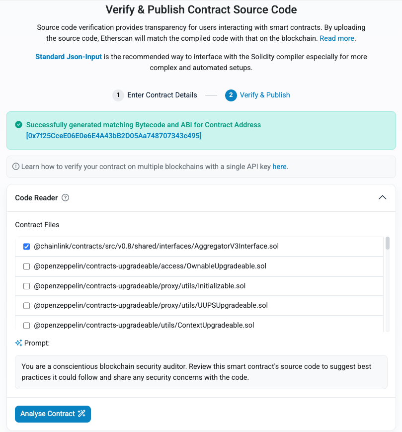

NFTAuction 实现合约在 Etherscan 上验证成功：

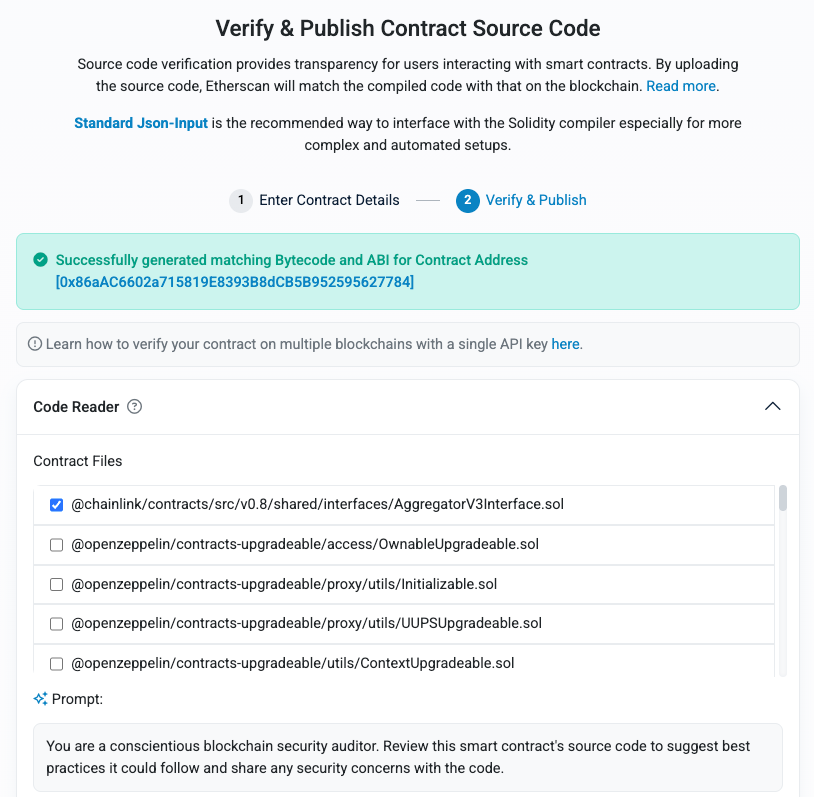

### 2. 代理合约（Blockscout 自动识别为 EIP-1967 代理）

Read/Write proxy 页面列出了实现合约的读函数（`auctions`、`getFeeBps`、`getUsdValue` 等）：

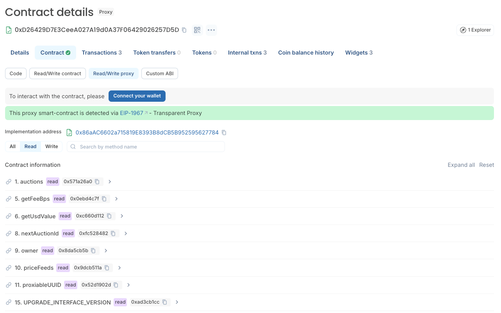

写函数（`bid`、`createAuction`、`endAuction`、`upgradeToAndCall` 等）：

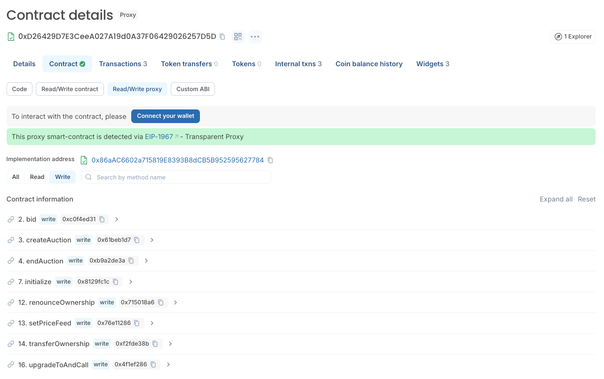

### 3. MyNFT 合约函数

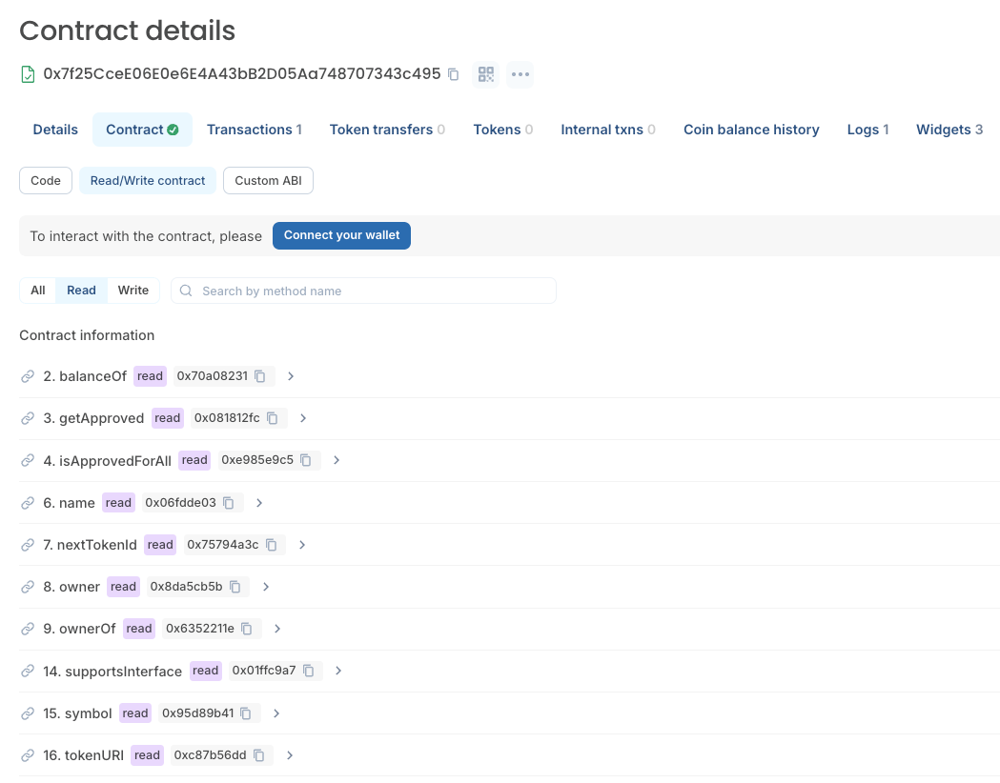

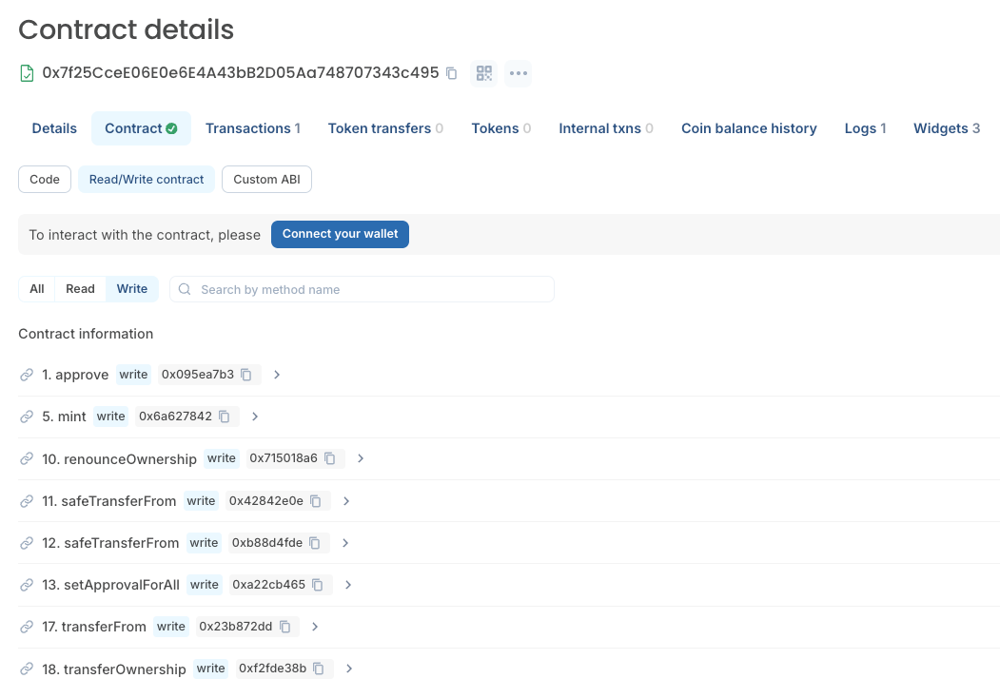

### 4. 拍卖流程

第 1 步：部署者铸造 NFT #0 给收款人1：

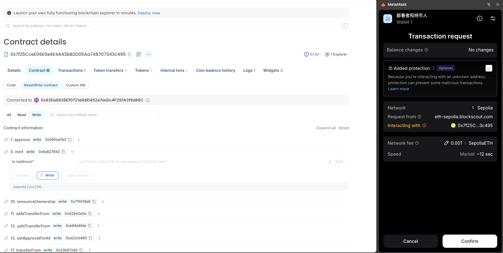

第 2 步：收款人1 授权拍卖代理合约转移 NFT #0：

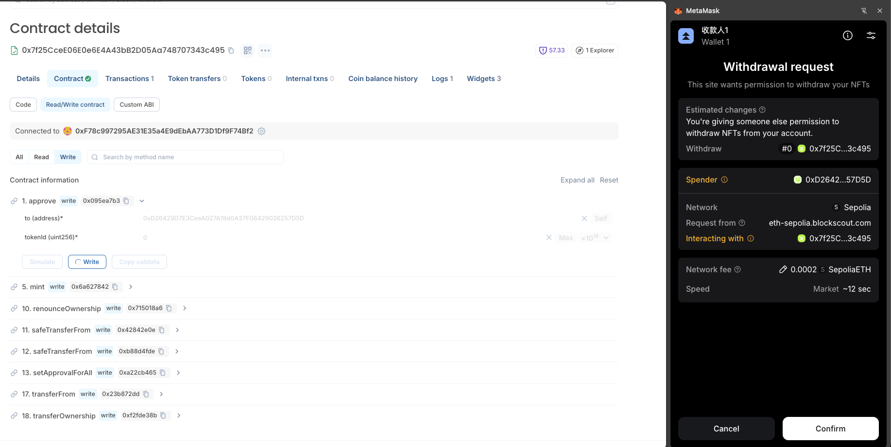

第 3 步：收款人1 上架拍卖（起拍价 $1，时长 900 秒），MetaMask 显示 NFT #0 将被转出：

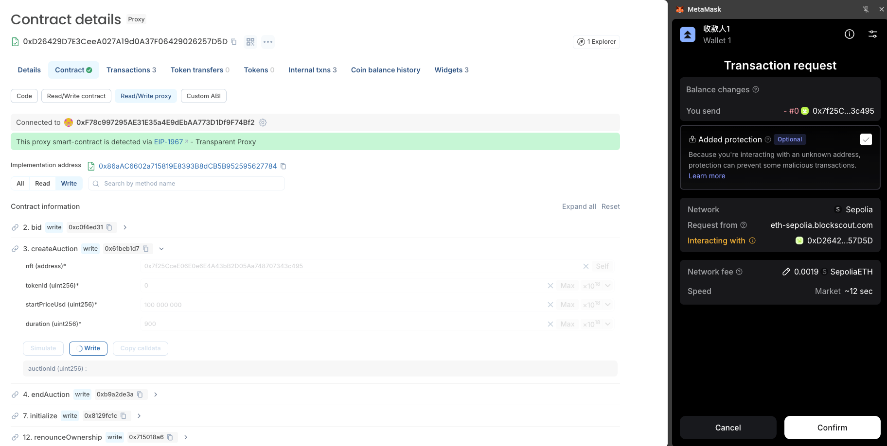

第 4 步：收款人2 用 0.01 ETH 出价：

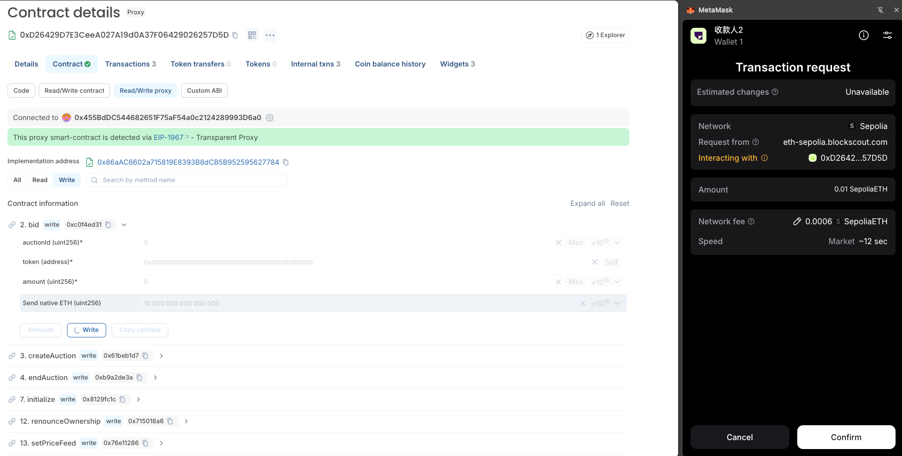

### 5. 拍卖结果：拍卖合约的资金流水

拍卖代理合约的转账记录（Etherscan → Token Transfers）。从下往上看，就是完整的资金流程：ETH 出价 → USDT 出价并退回 ETH → 结束拍卖，48.5 USDT 转给卖家、1.5 USDT 手续费转给平台：

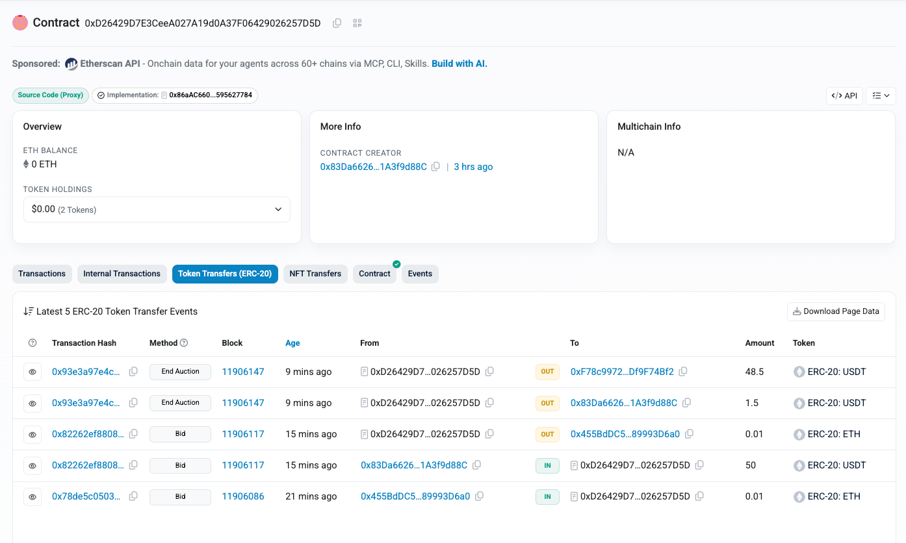

拍卖代理合约的 NFT 转移记录（Etherscan → NFT Transfers），展示 NFT #0 在拍卖中的完整流转：

- 第 2 行（createAuction）：上架时，NFT #0 从卖家收款人1 转进拍卖合约托管。
- 第 1 行（endAuction）：结束拍卖后，NFT #0 从拍卖合约转给赢家，也就是部署者。

> 第 2 行的 Method 列显示为 "Redeem Dele…"，是 Etherscan 推断函数名时出了错。交易 `0x737b3e77…` 实际调用的是 `createAuction`。

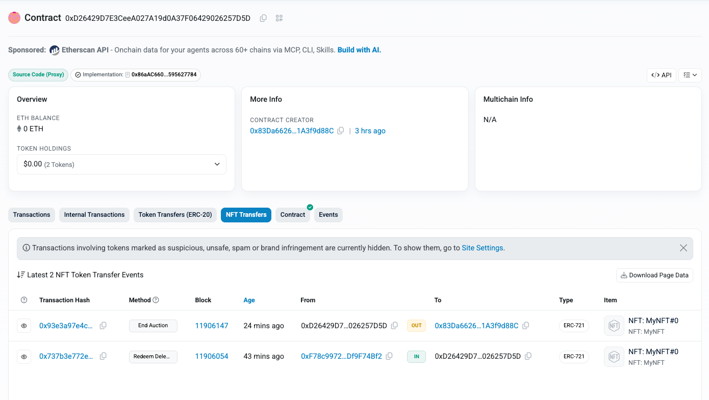

### 6. 拍卖结果：各角色的资金变化

按拍卖流程的顺序，依次列出每个参与者的资金变化。地址页截图来自 Etherscan → Token Transfers，只需看最上面几行和本次拍卖有关的记录，更早的记录是这些账户以前的其他交易。

#### ① 卖家（收款人1）`0xF78c…74Bf2`

- 第 1 行 **End Auction**：收到 48.5 USDT 成交款，即 50 USDT 扣掉 3% 手续费。
- NFT #0 在上架时转进了拍卖合约，转出记录见上一节代理合约的 NFT 转移记录。

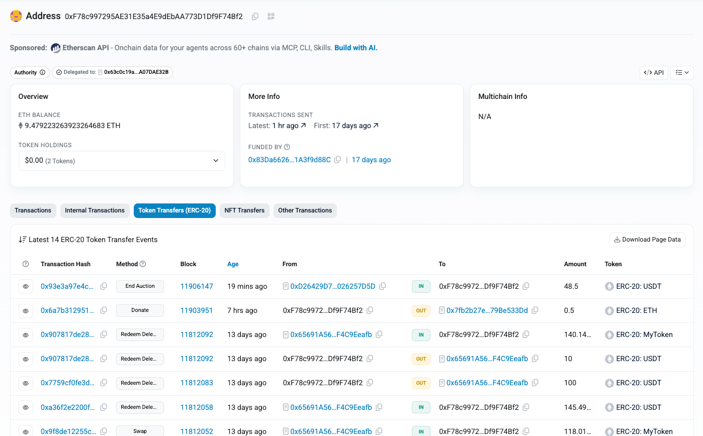

#### ② ETH 出价人（收款人2）`0x455B…D6a0`

- 第 2 行 **Bid**：转出 0.01 ETH 出价，折合 $25.00，成为当时的最高出价。
- 第 1 行 **Bid**：在部署者的 USDT 出价交易里，收到退回的 0.01 ETH，说明被超过后自动退款成功。

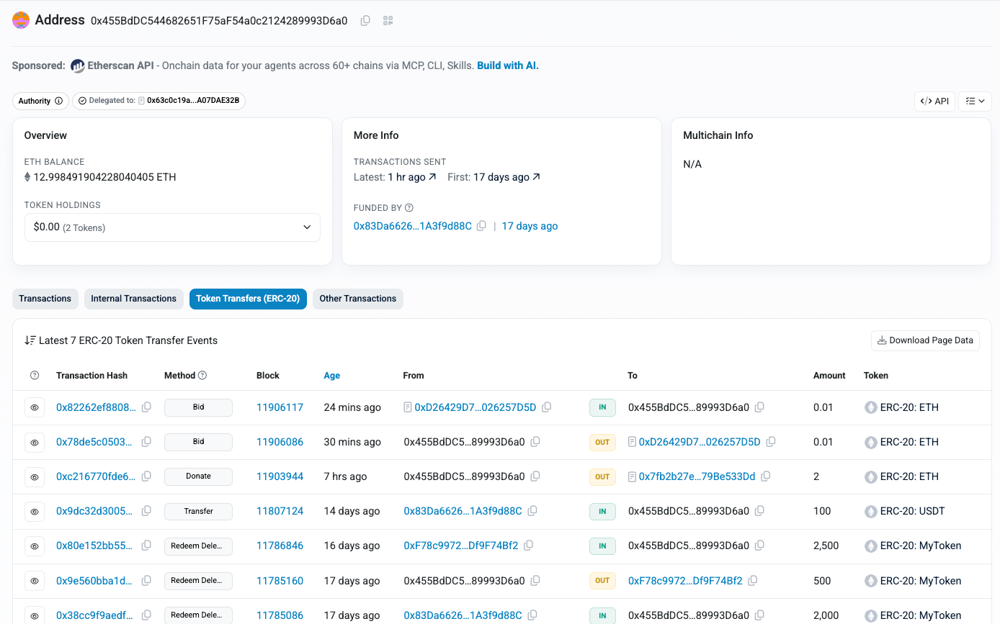

#### ③ USDT 出价人（部署者）`0x83Da…d88C`

交易 [0x82262ef8…](https://sepolia.etherscan.io/tx/0x82262ef8808ff205415b5d5137f4328c841903bbc3932ce6e771872748ff5905) 调用 `bid(0, USDT, 50000000)`，出价 50 USDT，折合 $49.99，超过 ETH 出价的 $25.00，成为最高出价。截图中各项对应关系：

- **Status: Success**，**From** 是部署者，**Interacted With** 是拍卖代理合约：出价交易成功。
- **ERC-20 Tokens Transferred** 第 1 行：50 USDT 从部署者转进拍卖合约，这是出价资金进入托管。
- **ERC-20 Tokens Transferred** 第 2 行、**Internal Transactions**、顶部的 **Transaction Action**：0.01 ETH 从拍卖合约退回给收款人2，这是被超过的出价自动退款。
- 出价和退款发生在同一笔交易里，收款人2 不需要自己做任何操作。

拍卖结束后，部署者作为赢家收到 NFT #0（见上一节代理合约的 NFT 转移记录）。

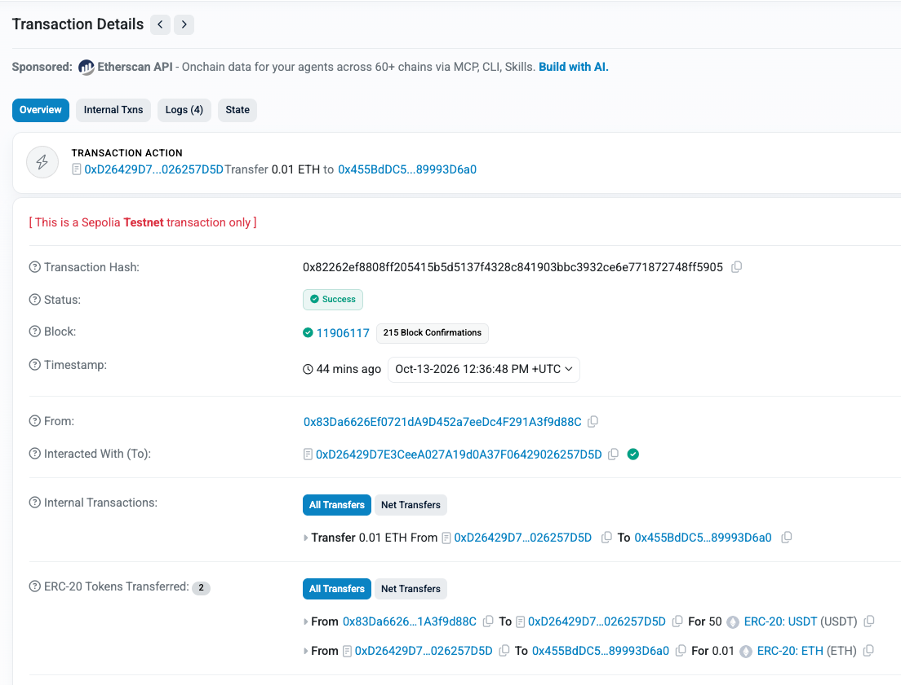

#### ④ 平台（部署者，合约 owner）`0x83Da…d88C`

- 第 1 行 **End Auction**：收到 1.5 USDT 平台手续费（成交价 $49.99 低于 $1,000，按 3% 收取）。
- 第 2 行 **Bid**：就是上面 ③ 中转出的 50 USDT 出价。

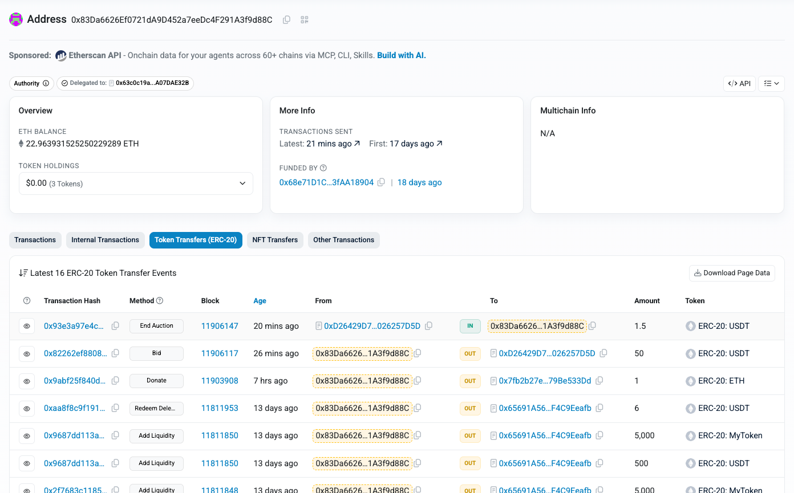

## 七、总结：三个角色在 NFT 拍卖中的资产流转

### 1. 流程时间线

拍卖合约（代理 `0xD264…7D5D`）在整个过程中充当**托管方**：NFT 和出价资金都先转进合约，等拍卖结束后再统一结算，买卖双方不需要互相信任。

```
 卖家（收款人1）          拍卖合约（托管）           ETH 出价人（收款人2）     部署者（USDT 出价人 / 平台）
       │                       │                           │                           │
 ①上架 │── NFT #0 ───────────▶│                           │                           │
       │                       │◀──────── 0.01 ETH ────────│ ②ETH 出价（$25.00）        │
       │                       │◀───────────────────────── 50 USDT ────────────────────│ ③USDT 出价（$49.99）
       │                       │──────── 0.01 ETH ────────▶│ 被超过，自动退款            │
       │                       │                           │                           │
 ④结束 │◀── 48.5 USDT ─────────│                           │                           │
       │                       │──────────────────────── NFT #0 ──────────────────────▶│ 赢得 NFT
       │                       │──────────────────────── 1.5 USDT ────────────────────▶│ 平台手续费
```

| 阶段 | 发生了什么 | 拍卖合约当时持有 |
| --- | --- | --- |
| ① 上架 | 卖家把 NFT #0 转进合约托管 | NFT #0 |
| ② ETH 出价 | 收款人2 出价 0.01 ETH，折合 $25.00，成为最高出价 | NFT #0 + 0.01 ETH |
| ③ USDT 出价 | 部署者出价 50 USDT，折合 $49.99，高于 $25.00；合约在同一笔交易里把 0.01 ETH 退给收款人2 | NFT #0 + 50 USDT |
| ④ 结束拍卖 | NFT 转给赢家；50 USDT 按 3% 费率拆分：48.5 给卖家，1.5 给平台 | 无（全部结清） |

### 2. 各角色的净结果

| 角色 | 转出 | 转入 | 最终结果 |
| --- | --- | --- | --- |
| **卖家**（收款人1） | NFT #0 | 48.5 USDT | 卖出 NFT，拿到成交价 50 USDT 扣除 3% 手续费后的部分 |
| **ETH 出价人**（收款人2） | 0.01 ETH | 0.01 ETH（退款） | 竞价失败，出价全额退回，只花了 gas 费 |
| **部署者**（USDT 出价人） | 50 USDT | NFT #0 | 以 50 USDT 赢得 NFT |
| **部署者**（平台 / 合约 owner） | — | 1.5 USDT | 收取 3% 平台手续费 |

> 本次测试中，部署者同时扮演了"USDT 出价人"和"平台"两个角色，所以实际净支出是 50 − 1.5 = 48.5 USDT。正式使用时，平台和买家通常是不同的地址。

### 3. 说明

- **两种币种如何比较**：ETH 和 USDT 无法直接比大小。合约通过 Chainlink 喂价把两次出价都换算成美元：0.01 ETH = $25.00，50 USDT = $49.99。所以 USDT 那次出价更高，胜出。
- **自动退款**：被超过的出价在新出价的同一笔交易里退回，用的是原来的币种（ETH 出价就退 ETH），出价人不需要再做任何操作。
- **手续费如何计算**：费率按成交价的美元价值定档（$49.99 低于 $1,000，所以是 3%），手续费用成交时的币种扣除，这里是 USDT。
- **失败的出价不影响状态**：测试中有一次 5 USDT（$5）的出价，因为低于当前最高价被合约拒绝（`bid too low`），交易回滚，资金没有转移，拍卖状态也没有变化。
- **资金全部结清**：拍卖结束后，合约里的 ETH 和 USDT 余额都是 0，没有资金滞留。
